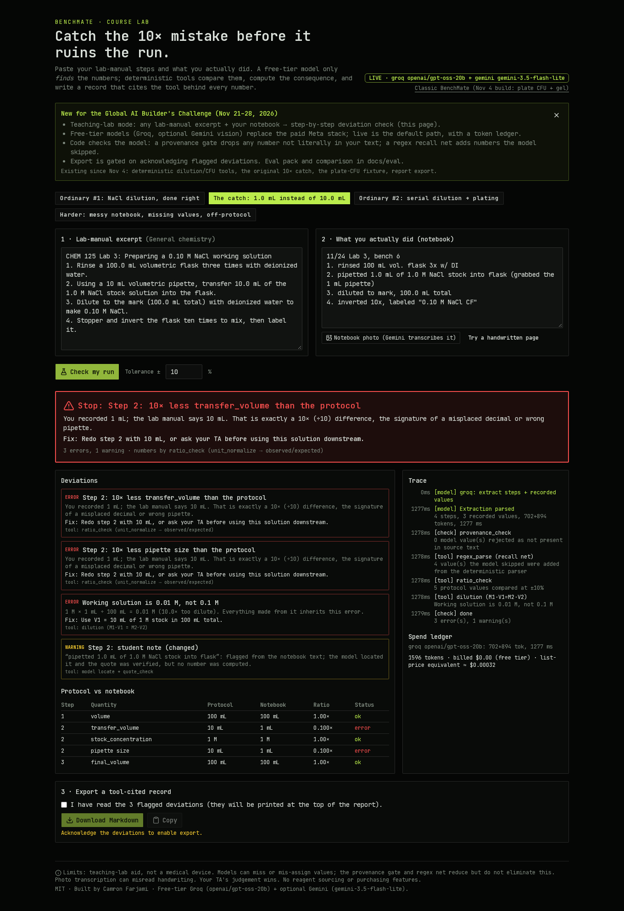
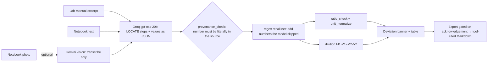

# BenchMate Course Lab

**A student lab partner that catches a 10× pipetting mistake before it ruins the run, and writes a record that cites every number's source.**

**Live (static, no install):** https://luxologygg.github.io/benchmate/ · built-in examples replay recorded model output; paste your own free Groq key (and optionally a Gemini key for photos) to run live in your browser.
**Full app (live server path):** `npm run dev` with free-tier keys, see [Quick start](#quick-start).

Built by **Camron Farjami** (University of Michigan), grounded in wet-lab bench work at USC Norris Comprehensive Cancer Center and Loma Linda. MIT licensed.
Entry for the **Global AI Builder's Challenge** (Devpost, Nov 21–28, 2026). This upgrades the existing BenchMate (Meta hackathon, Nov 3–4, 2026); what is new is listed in **[CHANGELOG-HACKATHON.md](CHANGELOG-HACKATHON.md)**.



## The problem (V1)

In a teaching lab, a student grabs the 1 mL pipette instead of the 10 mL one. The working solution is now 0.01 M instead of 0.10 M, every standard made from it is wrong, and nobody notices until the absorbance plot looks strange two hours (or two weeks) later. TAs cannot watch 24 benches at once, and the notebook that would show the mistake gets read after the lab, if ever.

**Use example.** Paste the lab-manual steps for CHEM 125 Lab 3 and type what you did (`pipetted 1.0 mL of 1.0 M NaCl stock`). Course Lab answers in about a second: *Stop: step 2, 10× less transfer volume than the protocol. Working solution is 0.01 M, not 0.1 M. Fix: use 10 mL of 1 M stock in 100 mL.* Each number in that sentence names the deterministic tool that produced it.

## How it works



* **The model only finds numbers.** One Groq call turns the manual and notebook into JSON (steps, quantities, roles such as `transfer_volume`, and which step each notebook value belongs to). It never computes.
* **Code checks the model (A2).** A value the model proposes is used only if that number is literally in the source text, and inside the model's quote when the quote is real. Hallucinated values are dropped and listed as `UNVERIFIED_EXTRACTION`. A deterministic regex parser then adds any number the model skipped.
* **Deterministic tools do all math.** `unit_normalize` → `ratio_check` flags exact powers of ten (10×, 100×) as `TEN_X_ERROR` and other drift beyond tolerance; `dilution` computes the concentration actually made and the corrected volume; `compute_cfu` + a 30–300 countable-range check for plate counts.
* **Fails safe.** No key → labeled fixture replay of recorded model output (checks still run live). Model error or rate limit → deterministic parser, with a visible warning. Photo transcription failure → typed-notes path, photo kept as evidence.
* **Minimal model use.** 1 call per check (2 with a photo), about 1.2–1.6k tokens, about 1 s. Free tier billed $0; the on-screen ledger shows the list-price equivalent (about $0.0002 per check).

## Quick start

```bash
npm install
cp .env.example .env.local       # add GROQ_API_KEY (free), optionally GEMINI_API_KEY (free)
npm run dev -- -p 43123          # http://127.0.0.1:43123
```

No keys? It still runs: the four built-in examples replay recorded Groq output (labeled **FIXTURE REPLAY**), and edited text goes through the deterministic parser.

| Env var | Needed for | Free tier |
| --- | --- | --- |
| `GROQ_API_KEY` | live extraction (default path) | yes, console.groq.com |
| `GEMINI_API_KEY` | optional notebook-photo transcription | yes, Google AI Studio |
| `COURSELAB_DEMO_MODE=true` | force the no-key fixture replay | n/a |

Third-party services: Groq API (`openai/gpt-oss-20b`), Google Gemini API (`gemini-3.5-flash-lite`), GitHub Pages (static hosting). Nothing is stored server-side; the static site keeps a pasted key in that browser tab only and sends it only to api.groq.com.

### Static build / deploy

```bash
npm run build:static            # → ./out (Course Lab only, browser-side pipeline)
./scripts/deploy-pages.sh       # publish ./out to the gh-pages branch
```

The static site cannot hold secrets, so it never ships a key. To host the full server path (keys on the server), deploy the Next.js app to any Node host (e.g. Vercel Hobby) and set `GROQ_API_KEY` / `GEMINI_API_KEY` as environment variables there.

## Evidence (R2–R5)

`npm run test:courselab` runs 10 deterministic unit tests (units, provenance gate, 10× catch, dilution consequence, CFU, fixture replay).
`npm run build && npm run eval:courselab` drives the production build in Playwright against live free-tier models and writes screenshots plus a results table to [`docs/eval/courselab/`](docs/eval/courselab/results.md).

| Case | Path | Result |
| --- | --- | --- |
| Ordinary #1: NaCl dilution done right | live | ✅ 0 errors |
| Ordinary #2: serial dilution + plating (CFU 4.20×10⁶/mL) | live | ✅ 0 errors |
| Repeat of ordinary #1 | live | ✅ same findings, identical table |
| The catch: 1.0 mL instead of 10.0 mL | live | ✅ `TEN_X_ERROR` step 2 + working solution 0.01 M |
| Harder: messy shorthand, missing units, off-protocol notes | live | ✅ equilibration −60% at step 4, temperature not recorded, off-protocol notes (e.g. no stopper, short wait) |
| Harder: handwritten notebook photo (Gemini) | live | ✅ 10× caught from the transcript |
| Failure: Groq key invalid | fallback | ✅ warning shown, deterministic parser still catches 10× |
| No key at all | fixture replay | ✅ labeled replay, checks run live |
| Empty input | UI | ✅ visible error + Retry |

Full write-up, comparison and limits: **[docs/eval/COURSELAB_EVAL.md](docs/eval/COURSELAB_EVAL.md)**.

## Comparison (V2)

Run 2026-11-25 by Camron's build agent on the same free model, asked directly as a chatbot (raw output: [`docs/eval/baseline-chatbot-2026-11-25.txt`](docs/eval/baseline-chatbot-2026-11-25.txt)).

| | Manual worksheet | Generic chatbot (same model, no tools) | BenchMate Course Lab |
| --- | --- | --- | --- |
| Catches the easy 10× case | only if a TA checks after lab | yes | yes, with the tool named for each number |
| Messy CuSO₄ notebook | nothing until results look wrong | lists real problems, then **invents numbers**: turns “lost maybe 1–2 **drops**” into “≈1.5 **mL**”, assumes a “2% reduction”, and reports a made-up **0.046 M** | flags the −60% equilibration time, the unrecorded temperature and the missed stopper, and refuses to guess a concentration it cannot compute |
| Repeatable | depends on the grader | free text, varies run to run | same findings on repeat (R3) |
| Export / record | handwritten | copy-paste | Markdown record; export locked until deviations are acknowledged |

## Honest limits

* Not a medical device and not for clinical samples. Teaching-lab protocols only. No reagent sourcing, vendors or prices.
* The model can miss a value or put it under the wrong step. The provenance gate and regex net reduce this but do not eliminate it. On the messy example, whether `250 flask` (no unit) is read as 250 mL changes between runs; it is reported as a missing value when the unit is absent.
* Qualitative problems (a wet beaker, no stopper) appear only when the student writes them down, and are shown as located notes, not computed findings. The chatbot baseline caught the wet beaker; Course Lab shows it only if the model flags it as a note.
* The handwritten-page example uses a handwriting-style font rendered on lined paper, not a scanned page. Real handwriting will be harder.
* Groq free tier allows roughly 8k tokens per minute for this model (about 5 checks a minute); the client retries once on a 429.

## Classic BenchMate (Nov 4 build)

The original Meta-hackathon app (SAM 3.1 plate-CFU overlay, gel bands, Muse Wonder trace) is still in the repo at **`/classic`** when you run the server. Its README is preserved at [`docs/README-classic-nov4.md`](docs/README-classic-nov4.md).

## Repo map

* `src/lib/courselab/`: pipeline, deterministic checks, provenance gate, free-tier client, samples, recorded fixtures
* `src/components/courselab/course-lab.tsx`: the UI
* `src/app/api/courselab/route.ts`: server route (keys from env)
* `scripts/test-courselab.ts`, `scripts/eval-courselab.mjs`, `scripts/record-courselab-fixtures.ts`, `scripts/build-static.mjs`, `scripts/deploy-pages.sh`
* `DEVPOST.md`: draft submission text · `DEMO_SCRIPT.md`: video script · `CHANGELOG-HACKATHON.md`: event delta

## License

MIT © 2026 Camron Farjami
