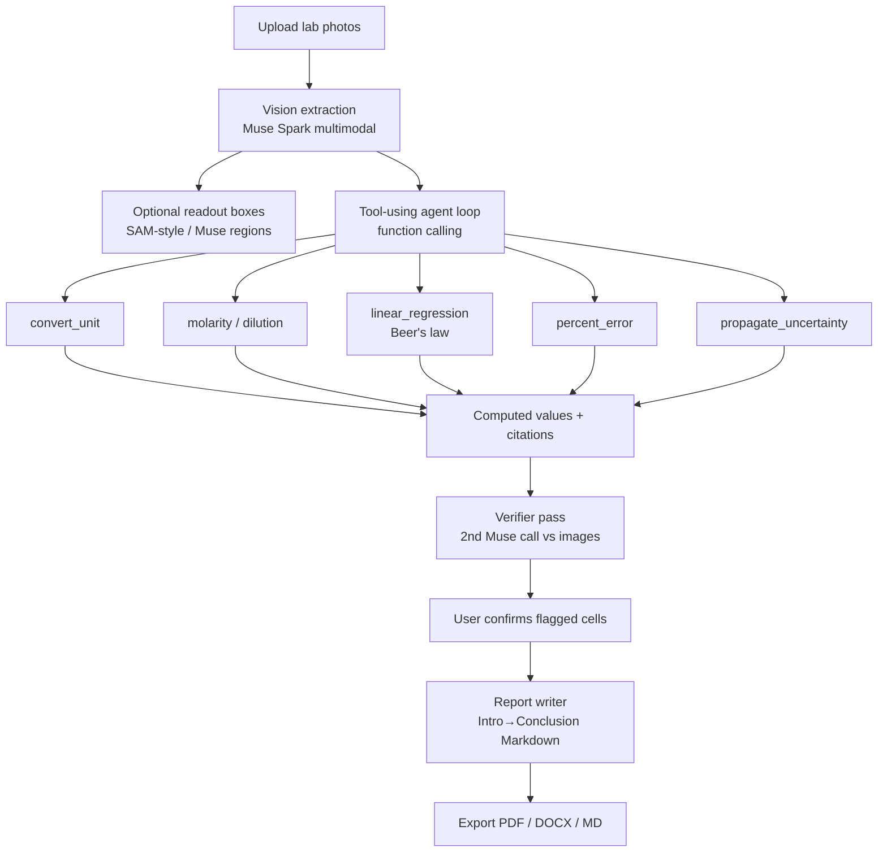

# BenchMate

**Photos of handwritten lab notebooks and instrument readouts → a verified, formatted lab report.**

Hackathon project for the **Meta Global AI Developer Hackathon** (deadline Nov 4, 2026).  
Solo builder: **Camron Farjami**, University of Michigan (pre-med, biology).

BenchMate is **not a chatbot**. It is an agentic pipeline: vision extraction → tool-using calculation agent → verifier → report writer → PDF/DOCX export.

[](#demo-mode)

## Problem

Undergrads and lab trainees spend hours retyping balance readouts, burette volumes, spectrophotometer screens, and notebook tables into reports — then still make unit and sig-fig mistakes. Existing OCR dumps text without chemistry-aware checks. Chatbots invent numbers.

BenchMate closes that gap: multimodal Muse models read the bench, **deterministic TypeScript tools** do the math, a second model pass verifies against the image, and a structured report cites which tool produced each number.

## Architecture



### How Meta models are used

| Stage | Model / product | Role |
| --- | --- | --- |
| Vision extraction | **Muse Spark** via Meta Model API (`muse-spark-1.3`) | Multimodal chat completions: image → structured JSON (values, units, sig figs, tables) |
| Segmentation (optional) | **SAM 3.1** (`sam-3.1`) via Responses API | Text-prompted boxes/masks for displays / tables; Muse Spark fallback |
| Calculation agent | Muse Spark + **function calling** | Plans steps; **all numbers come from local tools** (no LLM math) |
| Verifier | Second Muse Spark pass | Cross-checks extraction vs image; flags unit / impossible / sig-fig issues |
| Report writer | Muse Spark | Drafts formal lab sections using only verified + tool-cited numbers |
| Open-weight path | **Muse Spark Open** on Baseten (`meta-models/muse-spark-open-1026`) | Same OpenAI-compatible client; eligible for open-weight bonus |

API shape (verified against [dev.meta.ai](https://dev.meta.ai/)): OpenAI-compatible `POST /v1/chat/completions` at `https://api.meta.ai/v1`, images as `image_url` content parts, tools via `tools` / `tool_calls`.

## Built with Muse (Meta AI tooling)

BenchMate was partially **implemented by Meta models** via `scripts/muse-build/`:

| Role | Model | Job |
| --- | --- | --- |
| Planner / lead | `muse-wonder-1.0` | Break remaining work into tasks |
| Contributor | `muse-spark-1.3` | Write file patches from task specs |
| Reviewer | `muse-wonder-1.0` | Approve / request follow-ups |
| Final pass | Cursor | Build green, polish, demo, push |

Spend is hard-capped (~$40) in `scripts/muse-build/pricing.mjs`. Full task ledger, token usage, and estimated cost: **[docs/BUILD_LOG.md](docs/BUILD_LOG.md)**.

```bash
source scripts/load-meta-key.sh   # loads META_API_KEY from a local gitignored file
npm run muse:build                # Wonder plans → Spark implements → Wonder reviews
```

## Quick start

```bash
npm install
cp .env.example .env.local   # no keys required for DEMO_MODE
npm run dev -- -p 43123
```

Open [http://127.0.0.1:43123](http://127.0.0.1:43123).

### Demo mode

With `DEMO_MODE=true` (or no API keys), the app replays recorded fixtures for Beer's law, titration, and balance samples — end-to-end UI without network calls to Meta/Baseten.

```bash
npm run demo:record:demo-mode   # ~3 min Playwright walkthrough → artifacts/
```

### Live Meta API mode

```bash
source scripts/load-meta-key.sh
export DEMO_MODE=false
npm run dev -- -p 43123
# optional: DEMO_PORT=43123 npm run demo:record
```

### Live models

Defaults match [Meta Model API docs](https://dev.meta.ai/docs/overview): base `https://api.meta.ai/v1`, model `muse-spark-1.3` (vision, 1M context), SAM 3.1 as `sam-3.1`.

```bash
# Meta Model API (preferred)
META_API_KEY=...                 # or MODEL_API_KEY
META_API_BASE_URL=https://api.meta.ai/v1
META_MODEL=muse-spark-1.3
META_SAM_MODEL_ID=sam-3.1

# Optional: Muse Spark Open via Baseten (open-weight bonus)
BASETEN_API_KEY=...
BASETEN_MODEL_ID=meta-models/muse-spark-open-1026
MODEL_PROVIDER=auto              # auto | meta | baseten
```

## Scripts

| Script | Description |
| --- | --- |
| `npm run dev` | Next.js dev server |
| `npm run build` | Production build |
| `npm run start` | Start production server |
| `npm run generate:samples` | Regenerate fixture PNGs under `public/samples/` |
| `npm run demo:record` | Playwright DEMO_MODE walkthrough + video/screenshots |
| `npm run test:tools` | Unit tests for deterministic chemistry tools |

## Project layout

```
src/app/api/{extract,segment,agent,verify,report,export,health}/
src/lib/agent/          # vision, agent-loop, verifier, report-writer
src/lib/tools/          # deterministic math tools
src/lib/demo/fixtures.ts
src/components/benchmate/
public/samples/         # demo lab photos
artifacts/              # demo video + screenshots
SUBMISSION.md           # hackathon form draft + demo script
```

## Screenshots

See `artifacts/screenshots/` after `npm run demo:record`:

- Upload + sample selection  
- Vision extraction with bounding boxes  
- Tool citations + calibration chart  
- Verifier flags  
- Final Markdown report  

## License

MIT © 2026 Camron Farjami
