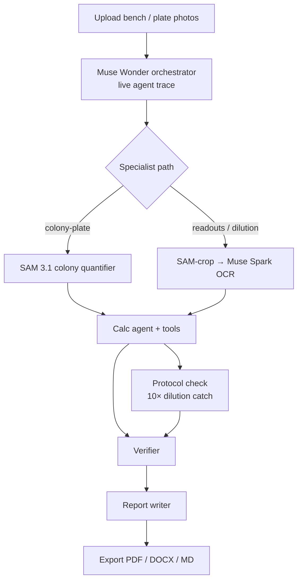

# BenchMate

**AI lab partner that watches your bench, catches errors before they ruin an experiment, and writes the record.**

Hackathon project for the **Meta Global AI Developer Hackathon** — *Build for Your World* / accelerating scientific experiments.  
Built by **Camron Farjami**, grounded in wet-lab research at **USC Norris Comprehensive Cancer Center** (oncology) and **Loma Linda**, with related work at [Homa](https://homa.bio).

BenchMate is for **wet-lab research trainees** — not a homework chatbot.

**Hero demos (DEMO_MODE):**
1. **Petri Dish — Colony CFU Count** — SAM 3.1 colony masks → deterministic `compute_cfu` → **4.2×10⁶ CFU/mL**
2. **Serial Dilution — 10× Protocol Catch** — Muse Wonder live agent trace + protocol-deviation banner when a trainee pipettes **1.0 mL instead of 10.0 mL**

[](#demo-mode)

## Problem

At the bench, a wrong dilution, a miscounted plate, or a blank that was never zeroed can waste a day’s reagents — or poison downstream analysis. Trainees still retype instrument and notebook values by hand. Plain OCR dumps text without lab-aware checks. Chatbots invent numbers.

BenchMate closes that gap: **SAM 3.1** segments what is on the plate, **Muse Wonder** orchestrates specialists with a live agent trace, multimodal **Muse Spark** reads labels and readouts, **deterministic TypeScript tools** do the math, a protocol check catches 10× pipetting mistakes, and a structured report cites which tool produced each number.

## Architecture



### How Meta models are used

| Stage | Model / product | Role |
| --- | --- | --- |
| Orchestration | **Muse Wonder 1.0** | Plans specialist steps; streams live agent trace |
| Colony segmentation | **SAM 3.1** (`sam-3.1`) | Colony boxes/masks; DEMO fixtures match ground-truth plate |
| CFU / chemistry math | Deterministic tools (`compute_cfu`, `dilution`, …) | **No LLM arithmetic** |
| Readout OCR / agent / verifier / report | **Muse Spark 1.3** | Vision JSON, function calling, consistency checks, report draft |
| Protocol check | Deterministic + Wonder trace | Flags **DILUTION_10X** before the working solution is used |
| Open-weight path | **Muse Spark Open** on Baseten | Open-weight bonus |

## Quick start

```bash
npm install
cp .env.example .env.local
DEMO_MODE=true npm run generate:samples
DEMO_MODE=true npm run dev -- -p 43123
```

Open [http://127.0.0.1:43123](http://127.0.0.1:43123).

1. **Petri Dish — Colony CFU Count** → Run pipeline (SAM masks + CFU)  
2. **Serial Dilution — 10× Protocol Catch** → Run pipeline (agent trace + deviation banner)

### Demo mode

`DEMO_MODE=true` (or no API keys) replays fixtures end-to-end — including **42 SAM-style colony masks**, `compute_cfu` → **4.2×10⁶ CFU/mL**, and the **10× dilution protocol catch** with a live Wonder agent trace.

```bash
npm run demo:record:demo-mode
```

### Live Meta API mode

```bash
source scripts/load-meta-key.sh
export DEMO_MODE=false
npm run dev -- -p 43123
```

```bash
META_API_KEY=...
META_API_BASE_URL=https://api.meta.ai/v1
META_MODEL=muse-spark-1.3
META_WONDER_MODEL=muse-wonder-1.0
META_SAM_MODEL_ID=sam-3.1
```

## Scripts

| Script | Description |
| --- | --- |
| `npm run dev` | Next.js dev server |
| `npm run generate:samples` | Fixture PNGs (colony plate + instruments) |
| `npm run demo:record` | Playwright walkthrough → `artifacts/` |
| `npm run test:tools` | Chemistry + CFU unit tests |
| `npm run test:orchestration` | Wonder orchestrator + 10× dilution catch tests |

## Built with Muse

| Role | Model | Job |
| --- | --- | --- |
| Planner / lead | `muse-wonder-1.0` | Runtime orchestration + muse-build planning |
| Contributor | `muse-spark-1.3` | Vision, calc agent, verifier, report, patches |
| Segmentation | `sam-3.1` | Colony / readout regions |
| Final pass | Cursor | Build green, polish, demo, push |

Spend cap ~$40 — see **[docs/BUILD_LOG.md](docs/BUILD_LOG.md)**.

## License

MIT © 2026 Camron Farjami
